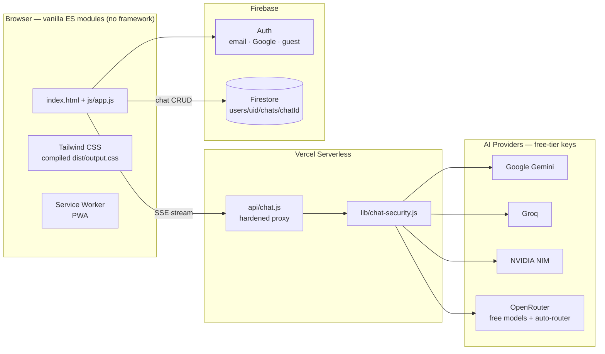

# ABot — AI Chat Hub

> 📄 **[`PROJECT-INFO.md`](PROJECT-INFO.md)** — machine-readable project facts (stack + exact versions, architecture, metrics, keyword tags) designed so an AI can generate resume entries and portfolio project summaries from it alone.

**One calm place to talk to 36 models from 4 providers** — Google Gemini, Groq, NVIDIA NIM, and OpenRouter's free tier — with streaming, markdown, and a warm, Claude-style design system. No framework, no build step for the app itself: vanilla ES modules all the way down.

> **Live demo:** https://abot-eta.vercel.app/
> **Repo:** https://github.com/abustark/abot

---

## Screenshots

<!-- TODO(owner): captures pending — will live in artifacts/ and be referenced here
     (light desktop, dark desktop, mobile). Requires running the app + browser, done on owner request. -->

| Light · Desktop | Dark · Desktop | Mobile |
|---|---|---|
| `artifacts/readme-light-desktop.png` | `artifacts/readme-dark-desktop.png` | `artifacts/readme-mobile.png` |

---

## Highlights

**Multi-model core**
- 36 models across **Google Gemini** (direct API), **Groq**, **NVIDIA NIM**, and **OpenRouter** free tier
- **OpenRouter Auto (Free)** — an auto-failover router that picks the best available free model
- Per-provider identity colors, per-chat model theming, per-request **web-search** and **thinking** toggles with capability gating (chips auto-disable where the provider doesn't support them)

**Chat experience**
- SSE streaming with throttled rendering (~100 ms flushes — no UI-thread freeze on phones), stop-generation via `AbortController`, live follow-scroll with jump-to-latest pill, auto-collapse for long messages
- Full markdown with lazy-loaded syntax highlighting, error cards with one-click retry
- Reactions, message pinning, optional timestamps, TTS (auto-read + per-message speak/stop), per-chat message search, draft leave-guard

**Chat management**
- New / inline-rename / delete-with-confirm, export to JSON **and** Markdown, **import chat**, sidebar search, current-chat chip with quick rename
- Prompt library with 9 system-prompt presets per chat

**Auth & accounts**
- Email/password (signup, login, forgot-password, email-verification gate), Google sign-in, and a **guest mode** (5-message limit + upgrade modal) so visitors can try it instantly

**Chrome & platform**
- Command palette (`Ctrl+K`), keyboard shortcuts (`Alt+N`, `Alt+/`), dark/light theme with system-preference pre-paint (no flash)
- Toast stack with swipe-dismiss, skeleton screens, tooltips
- **Installable PWA**: manifest + service worker, safe-area insets, keyboard dock for mobile

---

## Architecture



**Why no framework?** Deliberate, documented decision — see [`docs/UI-COMPONENTS-ROADMAP.md`](docs/UI-COMPONENTS-ROADMAP.md) for the rationale and the conditions that would trigger a revisit.

**Frontend modules** (`js/`, dependency order): `config.js` (model registry, colors, prompts) → `dom.js` → `state.js` → `utils.js` → `ui.js` → `auth.js` → `chat.js` → `app.js` (entry). Extracted verbatim from the original inline monolith with **token-level parity verification** (`tools/verify-parity.js`). Details: [`js/README.md`](js/README.md).

**Backend mirror:** `server.js` replicates `api/chat.js` for local dev, sharing `lib/chat-security.js` so prod and local enforce identical rules.

---

## Security & quality gates

This is the part most portfolio projects skip.

- **Hardened serverless proxy** (`api/chat.js`): rate limiting, request size caps, verified-email enforcement (Firebase Admin), generic error envelopes — provider keys never reach the browser
- **Strict CSP + security headers** in `vercel.json` (nosniff, frame-deny, HSTS, locked-down connect-src to exactly the APIs used)
- **Firestore rules**: per-user isolation (`users/{uid}` only, everything else denied) — [`firestore.rules`](firestore.rules)
- **Test suite** (`npm run test`):
  - `tests/chat-security.test.js` — backend security contract
  - `tools/interaction-test.js` — clicks **every shell control** in jsdom and asserts the visible effect
  - `tools/cycle-test.js` — behavior regressions (e.g. mobile keyboard dismissal after send)
  - `tools/smoke-node.js` — jsdom runtime walk of logged-out/logged-in init paths
- **Plus**: ESLint (`npm run lint`), acorn syntax check of every JS file (`npm run check`), TypeScript checking via JSDoc (`npm run typecheck`), Python security-header audit (`tools/test-security.py`), Playwright E2E (`tools/test-playwright.py`), visual regression (`npm run visual:local`)
- **Pre-commit hook** runs syntax + lint on every commit (`.githooks/`, wired by `npm ci`)

---

## Getting started

```bash
npm ci                  # installs deps + wires .githooks via prepare
cp .env.example .env    # fill in Firebase + provider keys (all have free tiers)
node server.js          # local dev server (mirrors the Vercel function)
npm run watch:css       # in another terminal, if you're touching styles
```

**Environment variables** (see [`.env.example`](.env.example)): Firebase client config, Google OAuth client ID, Firebase Admin service-account JSON, and the four provider keys (`GEMINI_API_KEY`, `GROQ_API_KEY`, `NVIDIA_API_KEY`, `OPENROUTER_API_KEY`). All providers used have free tiers — the app is designed around them.

**Deploy:** push to `main` → Vercel serves `index.html` statically and `api/chat.js` as a serverless function (60 s max duration for long streams).

---

## Project layout

```
index.html            # app shell (single page)
js/                   # frontend ES modules (see js/README.md)
api/chat.js           # Vercel serverless proxy (production)
server.js             # local dev mirror of api/chat.js
lib/chat-security.js  # shared backend hardening
src/input.css         # Tailwind source + design tokens → dist/output.css
tests/ tools/         # security tests, interaction/cycle/smoke/visual suites
docs/                 # commit log, roadmap, rules docs
```

## Docs worth reading

- [`COMMIT-HISTORY.md`](COMMIT-HISTORY.md) — full versioned commit history
- [`BUGS-AND-FIXES.md`](BUGS-AND-FIXES.md) — bug registry: symptom → root cause → fix, 49 entries and counting
- [`AGENTS.md`](AGENTS.md) — the operating brief (branch discipline, quality gates, hard rules)

## License

ISC

